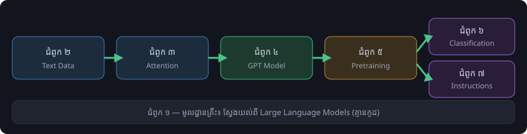

.. meta::
   :description: ឯកសារសហគមន៍ភាសាខ្មែរសម្រាប់គម្រោង LLMs-from-scratch របស់ Sebastian Raschka — សង្ខេបព័ត៌មានពិតពីឃ្លាំងកូដផ្លូវការ។ Khmer community documentation for the LLMs-from-scratch project by Sebastian Raschka.
   :keywords: LLM, GPT, PyTorch, ខ្មែរ, Khmer, from scratch, ឯកសារ, documentation

==========================================================
LLMs ពីមូលដ្ឋាន — ឯកសារសហគមន៍ភាសាខ្មែរ
==========================================================

នេះជាគេហទំព័រឯកសារសហគមន៍ (community documentation) ភាសាខ្មែរ ដែលសង្ខេបព័ត៌មានពិតៗ
ពីឃ្លាំងកូដផ្លូវការ `rasbt/LLMs-from-scratch <https://github.com/rasbt/LLMs-from-scratch>`_ —
ឃ្លាំងកូដផ្លូវការសម្រាប់សៀវភៅ *Build a Large Language Model (From Scratch)* របស់
Sebastian Raschka (Manning)។ ឃ្លាំងកូដនេះណែនាំការអភិវឌ្ឍ (develop) ការបណ្តុះបណ្តាលមុន
(pretrain) និងការកែសម្រួល (finetune) ម៉ូដែលភាសាធំស្រដៀង GPT ដោយប្រើ PyTorch
ពីមូលដ្ឋាន ដោយមិនប្រើបណ្ណាល័យ LLM ខាងក្រៅ។
គ្រប់ជំពូក និងភាគបន្ថែមមាន **companion notebook ជាភាសាខ្មែរ** (កូដដូច upstream ១០០%
ព្រមទាំងការពន្យល់ និង comments ជាខ្មែរ) — សូមមើល :doc:`យោង/ណូតប៊ុក-ខ្មែរ`។

.. note::

   ឯកសារនេះជាការបកប្រែ/សង្ខេបរបស់សហគមន៍ — **មិនមែនជាឯកសារផ្លូវការ** របស់អ្នកនិពន្ធ
   ឬក្រុមហ៊ុន Manning ទេ។ ប្រភពចម្បងដែលត្រូវយកជាគោលគឺឃ្លាំងកូដ upstream ភាសាអង់គ្លេស។
   អត្ថបទ និងរូបភាពក្នុងសៀវភៅជាកម្មសិទ្ធិរបស់ Manning — គេហទំព័រនេះមិនចម្លងវាទេ។

កំណែដែលឯកសារនេះតាមដាន
------------------------

ឃ្លាំង upstream មិនមាន tag ឬ release ផ្លូវការទេ — ការអភិវឌ្ឍធ្វើឡើងផ្ទាល់លើសាខា ``main``។

.. list-table::
   :header-rows: 1
   :widths: 20 30 50

   * - ស្ថានភាព
     - កំណែ
     - ព័ត៌មាន
   * - Release (stable)
     - ``main`` @ ``cdbd33e`` (2026-10-02)
     - commit ចុងក្រោយនៃឃ្លាំង upstream នៅពេលឯកសារនេះត្រូវបានបង្កើត
   * - Beta
     - —
     - upstream មិនប្រើសាខា beta ទេ
   * - Dev
     - `main <https://github.com/rasbt/LLMs-from-scratch/tree/main>`_
     - សាខាអភិវឌ្ឍន៍ផ្ទាល់របស់ upstream

ផែនទីបង្ហាញផ្លូវសិក្សា
----------------------

   លំហូរមាតិការបស់សៀវភៅ — រូបភាពដើមរចនាឡើងសម្រាប់ឯកសារសហគមន៍នេះ។

មាតិកា
------

.. toctree::
   :maxdepth: 2
   :caption: ការចាប់ផ្តើម

   ការចាប់ផ្តើម/ទិដ្ឋភាពទូទៅ
   ការចាប់ផ្តើម/ការដំឡើងបរិស្ថាន
   ការចាប់ផ្តើម/ការទាញយកកូដ

.. toctree::
   :maxdepth: 2
   :caption: ជំពូកស្នូល

   ជំពូក/ជំពូក១-ស្វែងយល់ពី-LLM
   ជំពូក/ជំពូក២-ទិន្នន័យអត្ថបទ
   ជំពូក/ជំពូក៣-សរសេរកូដ-attention
   ជំពូក/ជំពូក៤-ម៉ូដែល-GPT
   ជំពូក/ជំពូក៥-pretraining
   ជំពូក/ជំពូក៦-finetuning-classification
   ជំពូក/ជំពូក៧-finetuning-instructions

.. toctree::
   :maxdepth: 2
   :caption: ឯកសារយោង

   យោង/ភាគបន្ថែម
   យោង/សម្ភារៈបន្ថែម
   យោង/ណូតប៊ុក-ខ្មែរ
   យោង/វចនានុក្រម
   យោង/ឯកសារយោង

.. tip::

   ចាប់ផ្តើមពីទំព័រ :doc:`ការចាប់ផ្តើម/ទិដ្ឋភាពទូទៅ` ដើម្បីស្វែងយល់ពីរចនាសម្ព័ន្ធ
   និងតម្រូវការរបស់គម្រោង។
